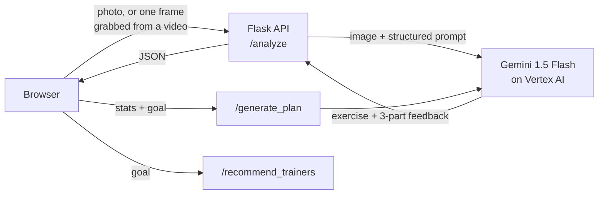

# AI Sports Coach

**Winner, Google DevFest 25: Build with AI**

Point a camera at your workout and get coaching back. AI Sports Coach looks at a photo or video of an exercise, works out what you're doing, and critiques your form: what you did right, what needs fixing, and how to improve. It can also build a personalized nutrition and workout plan from your stats and goal, and suggest trainers who match that goal.

Built on Gemini 1.5 Flash through Vertex AI on Google Cloud.

## What it does

- **Form check from a photo or video.** Gemini identifies the exercise (squat, deadlift, bench press, push-up and so on) and returns feedback in three parts: what you did right, what needs fixing, and coaching advice. For common lifts it also shows a reference video of good form.
- **Personalized plan.** Enter your age, height, weight, activity level and goal, and get daily calorie and macro targets, sample meals with portion sizes, and a weekly training split with sets and reps.
- **Trainer matching.** Recommends trainers whose specialties match your goal, with general-fitness coaches as a fallback.

## How it works



**Video never leaves the browser.** For a video, the page seeks just past the first frame, draws it onto a canvas and sends a single JPEG to the backend. Uploads stay small and fast, and the server only ever handles images.

**Structured output from a free-text model.** The UI needs specific fields, not an essay: the exercise name, three feedback sections, and a plan split into nutrition and workout. The prompts define a strict output contract (for example `Exercise Identified: Squat`, then the three labeled sections). The backend and frontend parse it with regex and fall back gracefully when the model drifts from the format. Safety-filter blocks and incomplete generations are caught and turned into clear errors instead of half-rendered results.

## Tech stack

| Layer | Tools |
|---|---|
| AI | Gemini 1.5 Flash, Vertex AI (Google Cloud), multimodal prompting |
| Backend | Python, Flask, Flask-CORS |
| Frontend | HTML, CSS, vanilla JavaScript, Canvas API |
| Auth | Google Cloud service account |

## Getting started

### Prerequisites

- Python 3.11+
- A Google Cloud project with the Vertex AI API enabled
- A service account key with the Vertex AI User role

### Setup

```bash
python3 -m venv venv
source venv/bin/activate        # Windows: venv\Scripts\activate
pip install -r requirements.txt
```

Create a `.env` file in the project root:

```env
GOOGLE_APPLICATION_CREDENTIALS=/absolute/path/to/service-account.json
GOOGLE_PROJECT_ID=your-gcp-project-id
GOOGLE_LOCATION=us-central1
```

Never commit the service account key. `.gitignore` already excludes `.env` and common key filenames.

### Run

```bash
python app.py                   # starts the API on http://127.0.0.1:5000
```

Then open `index.html` in your browser, or serve the folder with `python -m http.server 8080` and visit http://localhost:8080.

## API

| Endpoint | Body | Returns |
|---|---|---|
| `POST /analyze` | multipart form with an image `file` | `{ "feedback": "...", "exercise_name": "squat" }` |
| `POST /generate_plan` | `{ age, gender, weight, height, activity, goal }` | `{ "nutrition_plan": "...", "workout_plan": "..." }` (Markdown) |
| `POST /recommend_trainers` | `{ "goal": "muscle_gain" }` | `{ "recommendations": [ ... ] }` (up to 3) |

## Project structure

```
├── app.py            Flask API: Vertex AI setup, form analysis, plan generation, trainer matching
├── app.js            Frontend logic: uploads, video frame capture, response parsing, rendering
├── index.html        Page layout: form check, plan generator, trainer list
├── style.css         Styles
└── requirements.txt  Python dependencies
```

## Limitations and next steps

- Form feedback comes from a single frame. Sampling several frames, or tracking pose across the clip with MediaPipe, would catch problems that only show up mid-rep.
- Trainer data is a small sample list. A real version would pull from a trainer database with location filtering.
- The frontend calls the API at `127.0.0.1:5000`. Deploying it would need a configurable API URL and hosting for the Flask app (for example Cloud Run).
- Plans are AI-generated samples, not medical or professional advice.

## Team

Built at Google DevFest 25: Build with AI. Henry He was technical lead and owned the architecture, backend and Gemini integration. Teammates shaped the product direction and user experience and delivered the final pitch.
